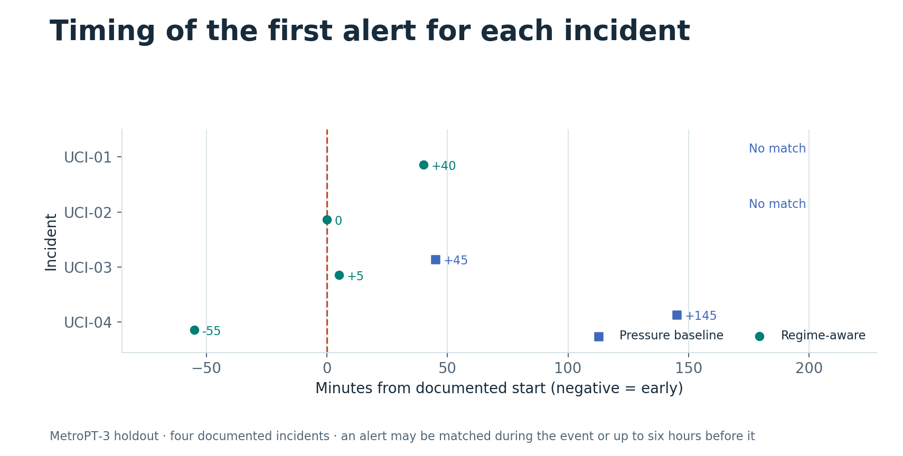
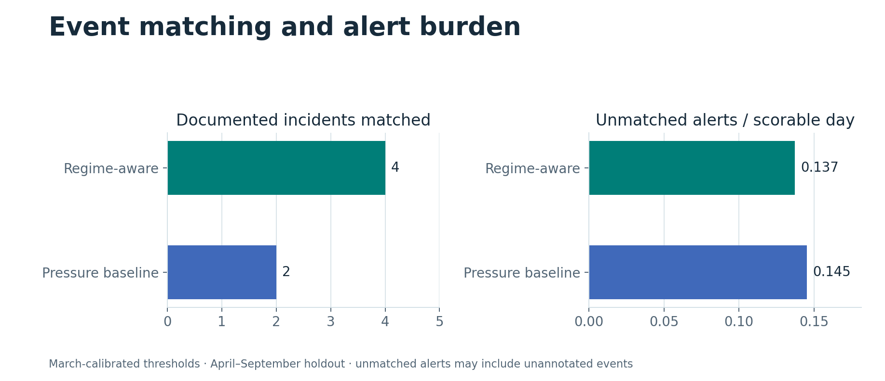
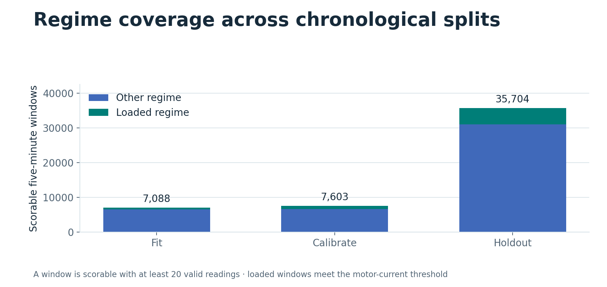
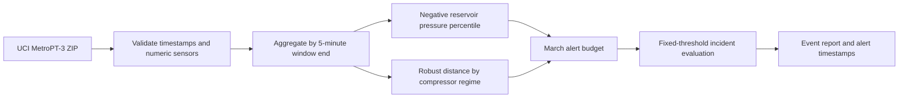

# Metro Compressor Event Detection

Benchmark a pressure-only alarm against a regime-aware multivariate detector on an operating train's compressor. Compare incident matches, lead times and unmatched alert burden after fixing thresholds on a prior month.

## Results

The UCI archive contains **1,516,948** observations. The dominant spacing is ten seconds. The pipeline formed **50,395** scorable five-minute windows and found **10,997** interior windows without a sufficient observation count.

| Threshold fixed on March data | Documented incidents matched | First alarm before start | Unmatched alerts per scorable day |
| --- | ---: | ---: | ---: |
| Low reservoir pressure | 2/4 | 0/4 | 0.145 |
| Regime-aware robust distance | 4/4 | 1/4 | 0.137 |

For the robust model, the four initial alerts occurred 40 minutes after, at the recorded start, 5 minutes after, and 55 minutes before incident start. Incident matching includes up to six hours before the start and the documented event interval. The four matches include detection while incidents were underway. [Measured outcomes](reports/holdout-metrics.json)

## Visual Results Gallery



A negative value denotes an early alert. The regime-aware model led the fourth incident by 55 minutes.



Evaluate matches and alert burden together. Unmatched alerts may include unannotated incidents.



The figure shows the amount of usable data in each chronological period.

Recreate the gallery from the reports or run outputs listed below.

```sh
python -m pip install -r requirements-visuals.txt
python plot_results.py
```

## Data and method



The reservoir baseline uses the within-window empirical lower decile. The robust distance uses median/MAD profiles fitted on February windows for loaded and other modes. Loaded windows have motor current at or above 6 A for at least 20% of sampled rows. Features include pressure summaries, oil temperature, pressure range and loaded fraction. Three consecutive windows above threshold trigger an alert at the end of the third window. Gaps reset streaks and a 30-minute cooldown suppresses repeat alerts.

Choose the lowest candidate quantile with at most one alert per scorable day in March. Freeze that threshold for the holdout beginning 1 April. The snapshot ends with a few hours on 1 September. Use event intervals from UCI. Each alert contributes to at most one incident or to the unmatched count. [Dataset schema, cadence and annotation caveats](data/README.md)

## Reproduction

Python 3.11+ and the standard library.

```sh
python metro_audit.py fetch --archive data/raw/metropt3.zip --sha256 aab991a970e58210de853bb8078ce0e63abb4d9412fdc5c79792dae3d8e1721a
python metro_audit.py audit --archive data/raw/metropt3.zip --sha256 aab991a970e58210de853bb8078ce0e63abb4d9412fdc5c79792dae3d8e1721a --out runs/holdout
python -m unittest discover -s tests -v
```

Open `runs/holdout/events.html`. It links to a detailed event report and a local alert CSV. The source ZIP is read without unpacking into the workspace.

## Limitations

Four incidents from one compressor give a narrow evidence base. Unmatched alerts can include unannotated failures or normal regime changes. Recorded boundaries can differ from physical onset. Scorable-day denominators omit absent and sufficiently sparse windows, which may bias estimated alert burden. The benchmark should be repeated on another vehicle and with independently recorded downtime before deployment.

## License and references

MIT for project code. Data licensed separately as CC BY 4.0. [UCI MetroPT-3](https://archive.ics.uci.edu/dataset/791/metropt%2B3%2B) · [Dataset DOI](https://doi.org/10.24432/C5VW3R)
